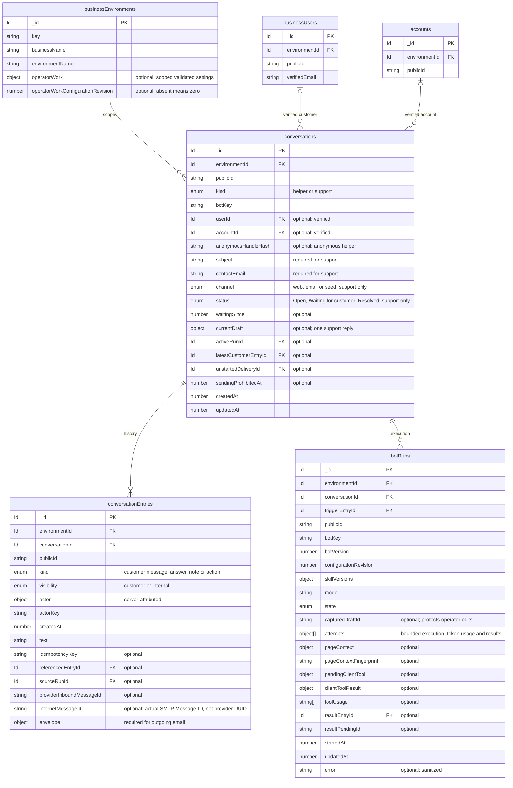
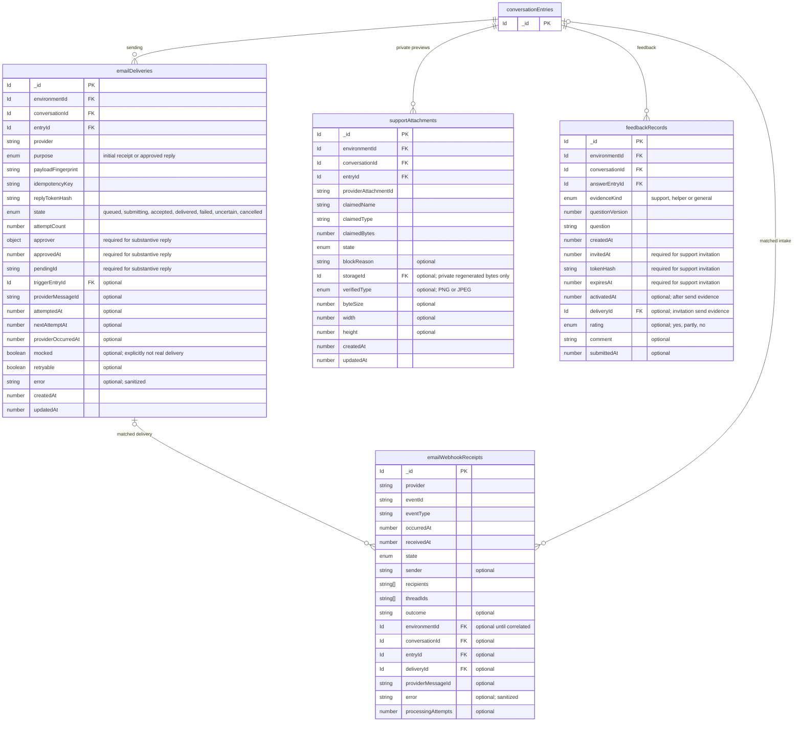
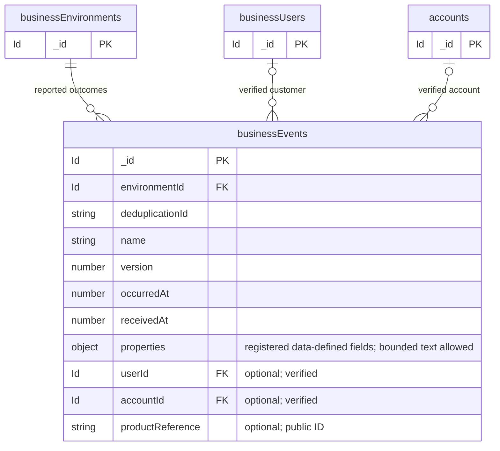
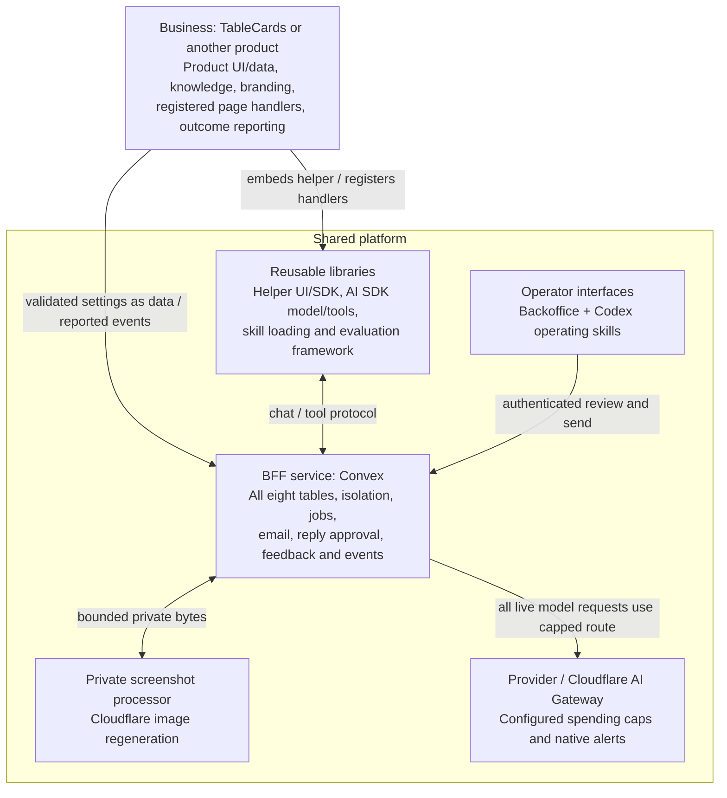

# Operator work — architecture

Created: 2026-10-09 · Updated: 2026-10-14 · Implementation baseline: `41ba411` · **Gemma/Jev checkpoint deployed and verified in production; no-charge preview**

Short review view of the [detailed brainstorm](../../.agent/brainstorms/261008-customer-operations-backoffice.md#proposed-erd).
Andrew approved the design/schema on 2026-10-09. The
[plan](../../.agent/plans/261009-operator-work.md) records implementation and
verification. Andrew separately authorized production on 2026-10-14; the
[release review](../../projects/tablecards/docs/reviews/261014-operator-work-production.md)
owns actual publication/smoke evidence and limits.

**Execution authorization — 2026-10-09:** after documentation checkpoint `41ba411`,
Andrew authorized unattended implementation and verification ending at development,
including necessary safe additive schema refinements. The
[implementation plan](../../.agent/plans/261009-operator-work.md) resolves settings
storage with optional `businessEnvironments.operatorWork` and optional
`operatorWorkConfigurationRevision`, plus indexed optional receiving-address/reply-domain
bindings. Existing rows remain disabled/revision zero when absent; no backfill,
required-field change, deletion or TableCards domain-table migration. Provider
credentials remain outside these fields. That original authorization excluded
production; the dated 2026-10-14 release request supersedes that restriction,
without authorizing real payments or customer launch.

## ERD

**Eight new tables, all in shared BFF.** `businessEnvironments`, `businessUsers`
and `accounts` already exist. Identity/account and TableCards domain data are reused;
Business configuration is stored as optional environment data, not product-specific shared code.
Fields below follow the implemented schema; existing entities show only relevant fields.
The [Convex schema](../../platform/bff/service/convex/schema.ts) is authoritative for exact validators/indexes.
`Id` means a native Convex reference; `FK` is diagram notation, not a SQL constraint.
Comments mark optional/conditional fields. Times are numeric UTC milliseconds.
Convex supplies `_id` and
`_creationTime`; the latter is omitted. Repeated boxes are the same table.

### Conversations and bot execution

### Email, attachments and feedback

### Business-reported events

The Business owns each event's name/version, property structure and display labels.
BFF validates a registered **data definition** using generic code; it does not
import Business validators. Event `properties` may include useful bounded text;
the shared `safeProperties` validator is not an automatic privacy guarantee.
Definitions, bot content and mailbox settings live in the optional environment snapshot.

**Business KPIs:** optional `operatorWork.kpis[]` contains a key, label,
description, measure (`event_count` or `active_customers`) and registered event
names. Business code owns these definitions; generic shared code derives seven-day
values from existing `businessEvents`. Active customers means distinct verified
users in matching events, not all visitors. Overview counters and sparklines
share one rolling seven-day sample; trends contain seven consecutive 24-hour
buckets. Distinct customers are counted independently per bucket and per
window, not summed across days. Each line has its own scale; expandable dated
counts provide exact evidence. One indexed read is bounded to 500 recent events;
truncated totals and trends are labelled lower bounds. No KPI table, new
index, lifetime-total claim or spending display. Older snapshots without KPIs
remain valid and display an unconfigured state.

**Customer event visibility (2026-10-10):** the customer query exposes the
Business label/version, registered properties and product reference on its
newest 30 linked events, with an explicit completeness flag. Customer history
pages use the existing environment/user/time index and require both a scoped
public customer ID and environment. No account-member aggregation, email-based
linking, unlinked-seed reassignment or raw Business database access. This changes
query projections only: no table/field/index migration.

Structured fields keep the diagrams compact; they are not unvalidated JSON:

| Field          | Contents                                                                                                                                                               |
| -------------- | ---------------------------------------------------------------------------------------------------------------------------------------------------------------------- |
| `currentDraft` | Recipient/body, source-run ID, editor/time, exact fingerprint, pending ID/state. No draft versions.                                                                    |
| `envelope`     | Immutable from/to/reply identity, subject/text, threading headers, feedback link and approved attachment references. Transport HTML is escaped from the approved text. |
| `attempts[]`   | Attempt ID, provider/model, execution outcome, optional token usage and tool-result references. No second transcript or monetary ledger.                               |

- `conversations`: one helper chat **or** support ticket—not one per person.
  Support has Open / Waiting for customer / Resolved and **one current draft**.
- `conversationEntries`: the single history of messages, replies and internal
  notes. Notes stay private; there is no second agent transcript or draft-version archive.
- `botRuns`: bounded model/tool execution and diagnostic usage; no budget-period,
  per-user spending or read-approval table.
- `emailDeliveries` references one immutable approved email; webhook receipts
  deduplicate notifications. Attachments store only private regenerated-preview references;
  feedback links to the actual answer. `businessEvents` stores safe product outcomes.

Customer/account links are optional and must be verified—not inferred from email.
All child records enforce Business/environment scope. Events may also link to a
verified customer/account. Webhooks remain unlinked until safely correlated.
Relationships are application-enforced Convex references, not SQL constraints.

**Helper retry recovery — 2026-10-13:** anonymous clients create a 256-bit
capability before the first request and keep it only in the identity-scoped
component's memory. The same question ID/capability survives a lost response;
it is not an authenticated identity or a persisted browser credential. Invalid
bearer tokens still fail, never downgrade to anonymous access.
The server authorizes the caller, matches the exact latest question and saved
page fingerprint, then reads its run through the existing conversation/trigger
index. A completed run replays only its original customer-visible answer after
environment/conversation/source-run checks, without another model call. Queued
or running duplicates cannot start another execution. Explicit failed-run retries
reuse the same active run only with unchanged configuration and fewer than three
attempts; no automatic retry, new table/index/field or migration is introduced.

**Provider safety cap — selected 2026-10-09:** configure the existing $3/day and
$30/month live-text ceilings at the provider/gateway, not in application tables.
All live model traffic must use the capped route; gateway enforcement can lag
concurrent calls. At the cap, handle AI unavailability without losing tickets or
bypassing the cap. Daily/delayed native provider alerts are acceptable; no custom
budget-alert transport or backoffice spending display. Exact native alert scope
and reset windows must be checked at setup. Per-user/account/anonymous spending
attribution returns to [Future Ideas](future-ideas.md#per-user-and-per-account-provider-cost-attribution).
The former `botBudgetPeriods` proposal is removed; existing credit tables and
TableCards image safeguards remain unchanged. Live text stays disabled until the
provider's actual window units/reset behavior and capped routing are verified.

**Development migration:** eight additive tables; optional environment settings/revision
and mailbox indexes; additive workflow lookup indexes and optional SMTP Message-ID.
Optional KPI definitions extend the configuration snapshot without backfill.
No old-row backfill, deletion, required-field tightening or TableCards domain-schema change.
Old messages without an SMTP ID omit reply headers and retain opaque reply-token correlation.

## Shared versus Business

### Bot configuration refinement — 2026-10-12

There is no `bots` table: each environment's optional `operatorWork` snapshot
holds `bots[]` (key, name, kind, version, instructions, model, assigned `skillKeys`)
and `skills[]` (key, version, name, `whenToUse`, content). Conversations identify
their bot key; `botRuns` capture configuration/bot/skill versions per execution.
Shared behavior instructions stay generic; Business facts and mandatory keys are
registered Business data, never hardcoded shared imports.

Andrew approved optional per-bot `knowledgeSelection: { strategy: 'inline' |
'jev', mandatorySkillKeys: string[] }` and `gemma4-26b` in the runtime model
allowlist. Jev allows at most 16 assigned sections, with unique mandatory keys
inside that assignment. Absent settings preserve legacy knowledge preparation.
Jev receives only assigned names/descriptions and bounded public question/history;
the backend adds mandatory content and falls back to all assigned content on
ambiguity/failure. The full fallback plus tool schemas must fit before selection
IO; every paid model step rechecks the serialized payload. No extra tool authority.
The answer model sees each configured page capability's exact registered
destination in its tool description; paths are trusted Business data, not guessed
domains or shared hardcoded product routes. Browser results/navigation still
require registered handlers and an explicit customer click.

This extends the stored configuration validator additively: deploy the BFF schema
before revision-checked activation. Existing records remain valid; no new table,
index, backfill, required field or domain-data migration. Runtime attempts retain
answer-model tokens only. Bounded `toolUsage` evidence identifies selector model,
fallback/effective sections and attempt-qualified selector call counts, including
browser pause/resume. Overflow is explicitly marked, not treated as complete
diagnostics. No reasoning transcript, selector-token attribution under Gemma,
cost table or new approval mechanism. Read-only support tools remain automatic;
substantive support replies still stop at a draft until the operator chooses Send.

**No Business-specific code in shared service/libraries.** Shared code owns generic
machinery. Business domain rules/validators and page/backend handlers stay in the
Business deployment; knowledge, event definitions, bot instructions, branding and
approved routes can be registered as non-executable data/settings in BFF. Generic
rendering/validation consumes those settings—no hardcoded product branches.
Business-specific evaluation/seed fixtures stay with the Business; runners are shared.
Shared React components include scoped default styles and accept `className`,
`style` and inherited `--bff-support-*` tokens. Business branding and optional
contact privacy wording stay in Business code; no TableCards palette/copy is
embedded in those shared defaults. This presentation refinement changes no schema.
The shared controlled `BffHelpSurface` supplies the persistent bubble, desktop
panel/phone sheet and native dialog/focus behavior. Business integration supplies
view state, content, identity remounting and navigation clearance, not a copied
launcher. Opening/closing the surface grants no tool or sending authority.
Server model/tools do not run in the browser. Client requests invoke
only registered Business handlers—never generated code. Resend sends/receives mail;
BFF owns tickets. Operators see only regenerated PNG/JPEG previews, never originals.
Regeneration reduces exposure; it is not an antivirus guarantee.
Private previews use authenticated bytes and browser blob URLs; backoffice CSP
permits `blob:` only for images, not scripts or network targets. Actual development
email intake and PNG/JPEG browser rendering are verified; production is unchanged.

**Implemented settings:** bot/skill content and versions; event property
definitions/labels; approved page tools/destinations; support sender/recipient/reply
bindings and branding; declarative Business KPI definitions. The validated operator CLI previews/applies this snapshot
with an expected revision and mailbox-collision checks. Registration uses administrative
authority; page metadata cannot grant server permissions. Exact reply Send instead uses
an admitted operator identity. No ninth table or configuration console.

**Support:** automatic permitted read-only lookups → one suggested draft → operator
edits/rejects/**Send** → deterministic email delivery. Send is approval. A new customer
message invalidates unstarted send authority but preserves the draft. Fixed initial
receipts and ordinary helper answers remain automatic; no account-changing tools.

**Data impact:** eight additive empty workflow tables; no existing-data backfill.
The optional environment configuration/revision and later optional KPI definitions
are backward compatible and need no backfill. Existing identity/account data is not duplicated. TableCards
keeps projects, guest/card contents, artwork, exports and AI batches in its own
database unchanged. Cross-deployment references use public IDs, not database joins.
The presented [fields, indexes and migration safeguards](../../.agent/brainstorms/261008-customer-operations-backoffice.md#proposed-table-changes-and-indexes)
are approved. Configuration persistence is implemented; development verification
and live-provider evidence remain separate from the accepted direction.
